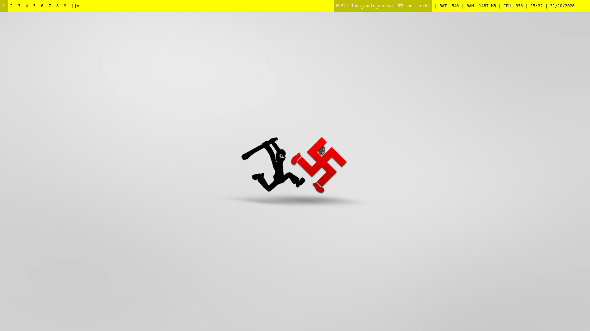
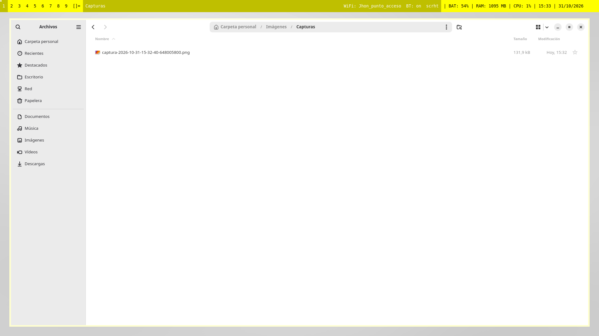
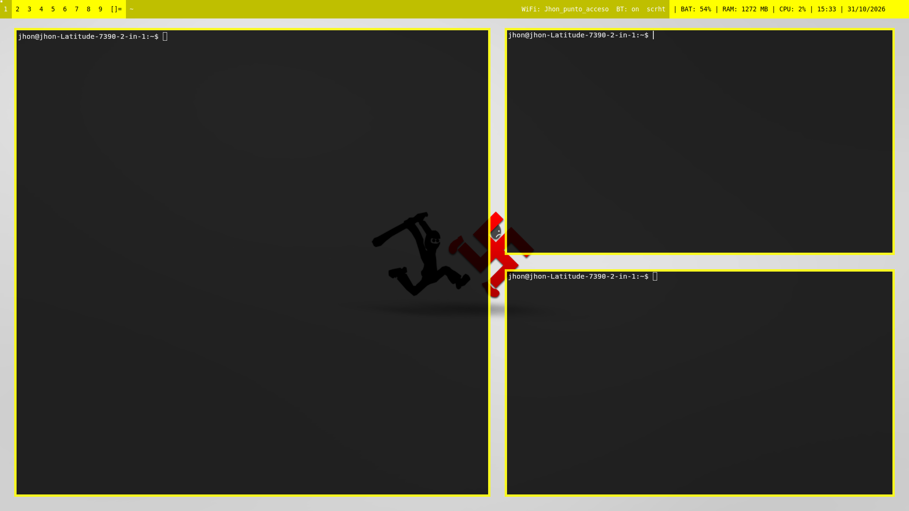
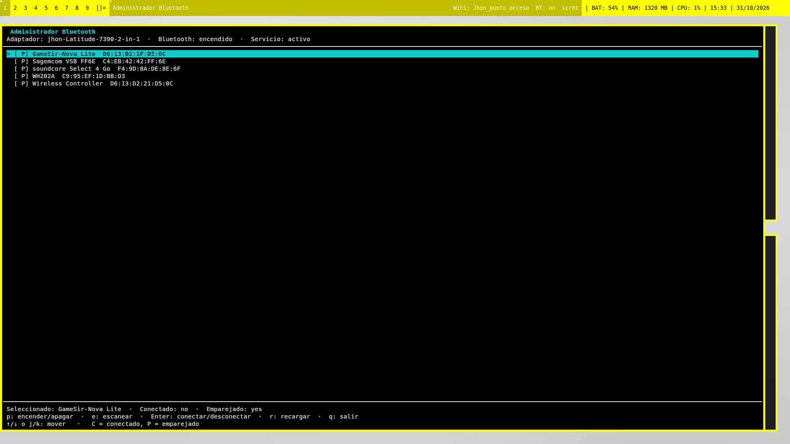
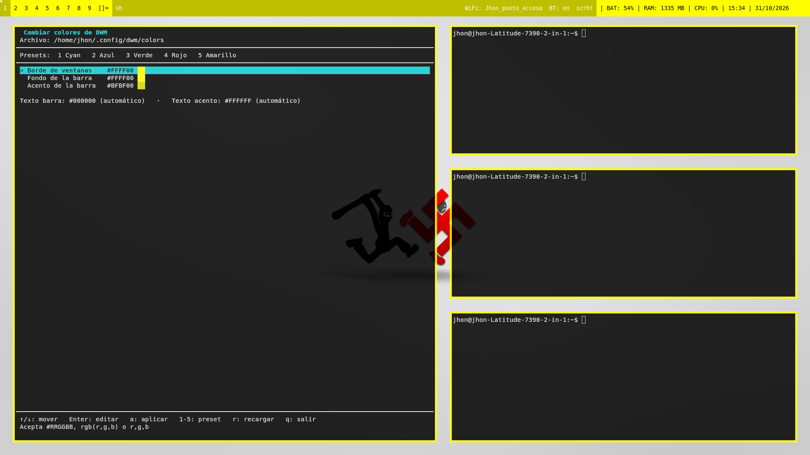

# MYDWM

Configuración personal de **DWM** con instalación automatizada para
**Debian/Ubuntu**, **Fedora** y **Arch Linux**.

## Compatibilidad

| Distribución | Gestor de paquetes | Soporte |
| --- | --- | --- |
| Debian / Ubuntu | `apt` | Paquetes y dependencias de compilación |
| Fedora | `dnf` | Paquetes y dependencias de compilación |
| Arch Linux | `pacman` | Paquetes y dependencias de compilación |

Los scripts detectan automáticamente la distribución mediante
`scripts/lib.sh` y usan los nombres de paquetes correspondientes. El flujo de
instalación, compilación y configuración es el mismo en las tres familias.

`xcape` se instala como dependencia opcional: si no está disponible en los
repositorios de la distribución (por ejemplo, en algunas versiones de Fedora),
el instalador continúa y lo advierte. En ese caso, `Super + P` sigue abriendo
dmenu; `xcape` solo es necesario para abrirlo pulsando **Super** sin combinación.

## Capturas











## Instalación rápida

```sh
cd ~/Documentos/MYDWM
make setup
```

El comando pide la contraseña de `sudo` para instalar paquetes y binarios del
sistema. Al terminar:

1. Cierra sesión.
2. En GDM selecciona la sesión **DWM**.
3. Vuelve a entrar.

También se puede usar el instalador de compatibilidad:

```sh
./install.sh
```

## Qué instala

### `make dwm`

- DWM compilado desde `src/dwm-6.8`, con:
  - Bordes de 5 px.
  - Separación de 30 px entre ventanas.
  - Separación de 20 px entre la barra y las ventanas.
  - Colores recargables en caliente desde `~/.config/dwm/colors`.
  - Bloques `Bateria`, `luz nocturna`, `WiFi` y `BT` clicables en la barra.
  - Atajos y reglas personalizadas.
- `picom` y `~/.config/picom/picom.conf`:
  - Ventanas y barra cuadradas.
  - Transparencia únicamente para kitty al 85 %.
  - Sin sombras.
- `scrot` y `/usr/local/bin/scrot-shot` para capturas de pantalla.
- `kitty` y `redshift`, usados por los atajos y por
  `redshift-night-scheduler`.
- Atajo `Ctrl+S` y bloque `scrht` en la barra para capturar la pantalla.

### `make bar`

- `slstatus` con:
  - Bloques `Bateria` y `luz nocturna`, que abren sus TUIs al hacer clic.
  - WiFi actual mediante `wifi-status` (`iwgetid` o `nmcli`).
  - Estado de Bluetooth.
  - Bloque `scrht` para capturas.
  - Batería, RAM, CPU, hora y fecha.
- `dmenu`.
- `slock`.
- `nmtui` para redes WiFi.
- Bluetooth:
  - `bluez`, `bluetoothctl`, `rfkill`.
  - `bt-status` para la barra.
  - `bluetooth-tui` para administrar dispositivos.
- Servicios `bluetooth` y `NetworkManager`.

### `make tuis`

- `wallpaper-tui`: selector de fondos con `feh`.
- `dwm-colors-tui`: editor de colores de bordes y barra.
- `bluetooth-tui`: dispositivos, escaneo, conexión y encendido/apagado.
- `battery-tui`: perfiles de energía con power-profiles-daemon o TLP 1.9+.
- `redshift-tui`: nivel manual de luz nocturna y horario automático.
- Accesos en dmenu:
  - Cambiar fondo de pantalla.
  - Cambiar colores de DWM.
  - Administrador Bluetooth.
  - Bateria.
  - luz nocturna.
- Carpeta `~/wallpapers` y fondo por defecto.
- Tema de colores por defecto, solo si no existe uno.

### `make xinit`

- `dwm-session`, `dwm-dmenu` y `redshift-night-scheduler`.
- `~/.xinitrc`.
- Entrada de sesión `/usr/share/xsessions/dwm.desktop`.
- La sesión inicia:
  - Fondo de pantalla persistente.
  - picom.
  - `redshift-night-scheduler` (respeta el modo manual o Auto).
  - slstatus.
  - xcape.
  - DWM.

## Estructura

```text
MYDWM/
├── Makefile
├── install.sh
├── LICENSE
├── README.md
├── INSTALL.md
├── ATAJOS.md
├── BLUETOOTH.md
├── DWM-COLORS.md
├── LUZ-NOCTURNA-Y-BATERIA.md
├── WALLPAPERS.md
├── SCREENSHOTS.md
├── GAMING.md
├── assets/
│   └── wallpapers/
├── configs/
├── screenshots/
├── scripts/
│   ├── lib.sh
│   ├── 01-install-dwm.sh
│   ├── 02-install-bar.sh
│   ├── 03-install-tuis.sh
│   ├── 04-configure-xinit.sh
│   ├── battery-tui
│   ├── bluetooth-tui
│   ├── bt-status
│   ├── dwm-colors-tui
│   ├── dwm-dmenu
│   ├── dwm-session
│   ├── redshift-night-scheduler
│   ├── redshift-tui
│   ├── scrot-shot
│   ├── wifi-status
│   └── wallpaper-tui
├── session/
└── src/
```

## Uso diario

- **Super** o **Super + P**: abrir dmenu.
- **Super + Shift + Enter** o **Ctrl + Alt + Z**: abrir kitty.
- **Clic izquierdo en `Bateria`** de la barra: abrir el selector de perfil de energía.
- **Clic izquierdo en `luz nocturna`** de la barra: abrir el selector de Redshift.
- **Clic izquierdo en `WiFi:`** de la barra: abrir `nmtui`.
- **Clic izquierdo en `BT:`** de la barra: abrir el administrador Bluetooth.
- **Ctrl + S** o **clic izquierdo en `scrht`**: captura de pantalla con `scrot`.
- **Cambiar fondo**: dmenu → *Cambiar fondo de pantalla*.
- **Cambiar colores**: dmenu → *Cambiar colores de DWM*.
- **Bluetooth**: dmenu → *Administrador Bluetooth*.
- **Perfil de energía**: dmenu → *Bateria*.
- **Luz nocturna**: dmenu → *luz nocturna*.

Los atajos completos están en [ATAJOS.md](ATAJOS.md).

## Luz nocturna y batería

`luz nocturna` guarda su estado en `~/.config/redshift-night`:

```text
mode=manual
percent=40
auto_percent=60
begin=20:00
end=07:00
kelvin=4500
```

- Con `mode=manual` se aplica `percent` hasta que se elija otra cosa.
- Con `mode=auto` se aplica `auto_percent` dentro de `begin`-`end` y 6500 K
  fuera de ese horario. El horario puede cruzar medianoche.
- Elegir un porcentaje manual cancela el modo Auto.
- `redshift-night-scheduler` relee el archivo cada 10 segundos, así que el
  cambio sobrevive al cierre de la TUI.

`Bateria` detecta automáticamente `power-profiles-daemon` o TLP 1.9+. Con TLP
usa `tlpctl` si está disponible; si solo existe el comando `tlp`, el cambio de
perfil pide autorización con `pkexec` o `sudo`. TLP 1.8 no admite los tres
perfiles y se muestra un aviso en la TUI.

## Verificación

```sh
make verify
```

Comprueba comandos, binarios, scripts TUI, accesos, configuraciones de sesión
y que DWM incluya la recarga de colores en caliente.

## Pruebas realizadas

- `make dwm`, `make bar`, `make tuis` y `make xinit` ejecutados individualmente
  en Ubuntu 26.04.
- `make setup` ejecutado de principio a fin en Ubuntu 26.04.
- `make clean` y compilación posterior desde fuentes limpias.
- `make verify` correcto.
- Las cinco TUIs arrancan desde `/usr/local/bin`.
- Los clics de `Bateria`, `luz nocturna`, `WiFi:` y `BT:` abren sus TUIs en una
  sesión DWM de prueba.
- `battery-tui` detecta power-profiles-daemon y aplica el perfil activo sin
  `sudo`. La ruta TLP 1.9+ está implementada, pero no se pudo probar en esta
  máquina porque TLP no está instalado (es incompatible con PPD).
- `Ctrl+S` y el clic en `scrht` generan capturas con `scrot` en una sesión DWM
  de prueba.
- El instalador probado con un `$HOME` vacío crea el tema, el fondo y los
  accesos correctamente.
- El fondo y el tema existentes del usuario no se sobrescribieron.
- La detección de `apt`, `dnf` y `pacman` y el mapeo de paquetes para Debian,
  Fedora y Arch están incluidos en los scripts; las pruebas funcionales se
  realizaron en Ubuntu 26.04.

## Estado del usuario

El instalador no sobrescribe estas preferencias si ya existen:

```text
~/.config/dwm/colors
~/.config/wallpaper
~/.config/redshift-night
~/wallpapers/
```

Las configuraciones que sí reemplaza (`picom.conf`, `~/.xinitrc`) se respaldan
con el sufijo:

```text
.bak.AAAA-MM-DD-HHMMSS
```

## Documentación

- [INSTALL.md](INSTALL.md): instalación paso a paso y resolución de problemas.
- [ATAJOS.md](ATAJOS.md): teclas y acciones del ratón.
- [WALLPAPERS.md](WALLPAPERS.md): selector de fondos.
- [DWM-COLORS.md](DWM-COLORS.md): editor de colores.
- [BLUETOOTH.md](BLUETOOTH.md): administrador Bluetooth.
- [LUZ-NOCTURNA-Y-BATERIA.md](LUZ-NOCTURNA-Y-BATERIA.md): luz nocturna,
  perfiles de energía y scheduler de Redshift.
- [SCREENSHOTS.md](SCREENSHOTS.md): capturas con `scrot`.
- [GAMING.md](GAMING.md): notas opcionales de Steam/Heroic (no forman parte de
  `make setup`).

## Notas

- `bluetuith` no forma parte del setup base; el administrador integrado es
  `bluetooth-tui`.
- Steam, Heroic y Proton 11 no se instalan automáticamente. `GAMING.md` recoge
  las notas de esta máquina.
- Los binarios compilados y objetos de `src/` pueden limpiarse con
  `make clean`; los binarios instalados en `/usr/local/bin` no se eliminan.
